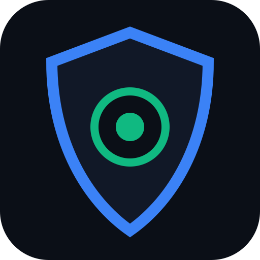

# ALETHEIA AI — Threat Intelligence & Truth Verification Platform

> Tactical misinformation detection, synthetic media analysis, and deepfake surveillance console.



---

## ⚡ Core Capabilities

- **Deepfake & Synthetic Video Detection:** Multi-frame keyframe extraction, temporal jitter analysis (88%+), diffusion boundary drift, and face-swap seam detection (Sora, Runway Gen-3, Kling, Pika, DeepFaceLab).
- **Social Media Auto-Resolution:** Automatically ingests and extracts high-resolution video keyframes directly from **TikTok**, **YouTube**, and OpenGraph web links.
- **Multimodal AI Support:** Seamless integration with **Groq** (`llama-3.2-11b-vision-preview`, `qwen/qwen3.8-27b`) and **Google Gemini** (`gemini-2.5-flash`), with offline forensic fallback.
- **Error Level Analysis (ELA) Studio:** Interactive visual tamper inspector detecting compression variance, spliced artifacts, and copy-move forgery.
- **Progressive Web App (PWA):** Installable on iOS, Android, and Desktop with offline forensic capability.

---

## 🚀 Quick Start

### Prerequisites
- [Node.js](https://nodejs.org/) (version 18+ recommended)
- Git

### 1. Clone the repository
```bash
git clone https://github.com/<your-username>/aletheia-ai.git
cd aletheia-ai
```

### 2. Install dependencies
```bash
npm install
```

### 3. Configure Environment Variables (Optional)
Copy `.env.example` to `.env`:
```bash
cp .env.example .env
```
Add your free API key (either Groq or Gemini):
- **Groq:** Get a free key at [console.groq.com/keys](https://console.groq.com/keys)
- **Google Gemini:** Get a free key at [aistudio.google.com/apikey](https://aistudio.google.com/apikey)

*(Note: The platform functions even without an API key using built-in forensic heuristic engines!)*

### 4. Run Locally
```bash
npm run dev
```
Open [http://localhost:3000](http://localhost:3000) in your browser.

---

## 🛠️ Tech Stack
- **Frontend:** React 19, TypeScript, Tailwind CSS, Lucide Icons, Framer Motion
- **Backend:** Node.js, Express, Vite middleware
- **AI Engines:** Groq Llama/Qwen Vision, Google GenAI SDK, HTML5 Canvas Offscreen Keyframe Decoder

---

## 🔒 Security & Privacy
- Zero private API keys are tracked in git (`.gitignore` protects all `.env*` files).
- Media processed client-side via canvas and transmitted securely via transient HTTPS payloads.

---

## 📄 License
MIT License
